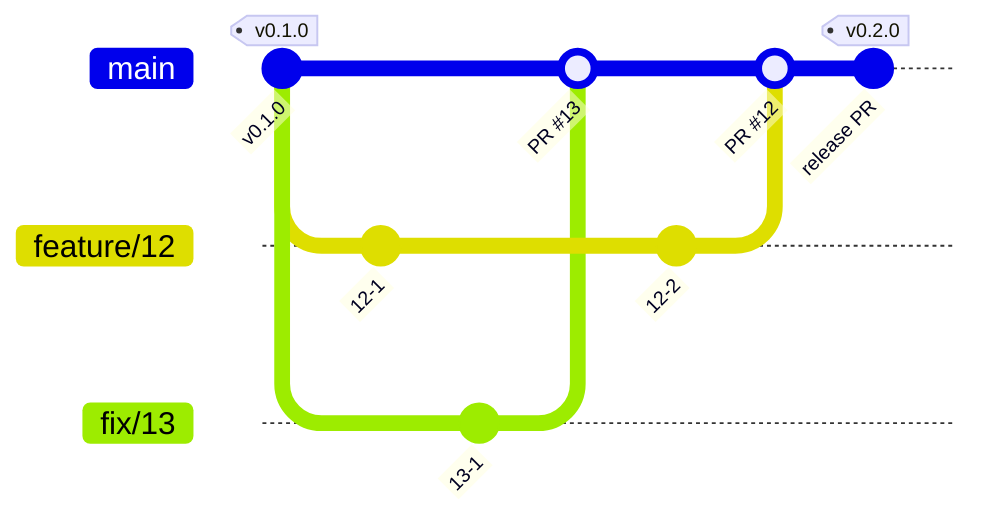
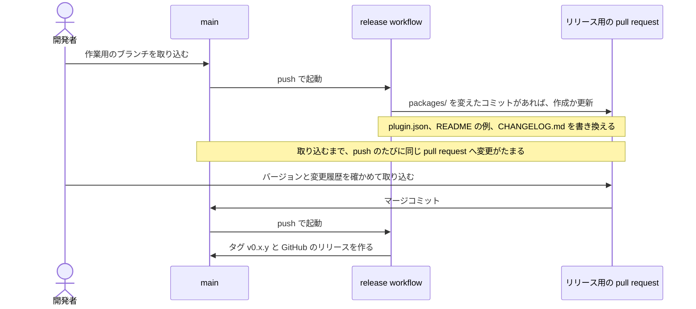

# 開発の準備

必要なものは mise である。Node.js、pnpm、apm のバージョンは `mise.toml` にある。

```sh
mise install
pnpm install
```

`pnpm install` は、`prepare` で lefthook の Git のフックを入れる。

スキルとフックは apm で配置し、Git で追跡しない。clone した後の最初のセッションで、セッションの開始のフックが配置する。手で配置するときは次を実行する。

```sh
apm install --frozen
```

`apm install` の後に配置先を `.gitignore` に足す post-install は、マシンごとに 1 度信頼させる。

```sh
apm lifecycle trust
```

## 文書を直すとき

文章の規則は textlint で、経緯の混入とリンクは docs のスクリプトで確かめる。指摘された語は言い換え、`--fix` は使わない。パッケージのスキルと playbook も、同じ規則で書く。

```sh
pnpm exec textlint <直した Markdown>
node .claude/hooks/docs/hooks/check-history.mjs
node .claude/hooks/docs/hooks/check-links.mjs
```

## パッケージを直すとき

- スキルの書き方は、スキル write-skill に従う。`SKILL.md` は 150 行以内に保つ。
- playbook を足すときは、`packages/playbooks/skills/run-playbook/playbooks/<名前>.md` を作り、スキル run-playbook の索引に 1 行を足す。principle も同じく `principles/<名前>.md` に置き、索引に足す。
- playbook を足したときは、`evals/run-playbook.json` に、その playbook が選ばれるべき依頼を 1 つ足す。
- 直したパッケージを、評価で確かめる。仮の利用者にパッケージを入れ、依頼ごとに期待した playbook が選ばれるかを、モデルごとに試す。モデルを実際に動かすので、使うモデルを絞って実行してよい。

```sh
node scripts/eval-run-playbook.mjs            # haiku、sonnet、opus で試す
node scripts/eval-run-playbook.mjs sonnet     # 1 つのモデルで試す
```

## コミットするとき

コミットの前に、lefthook が次を確かめる。設定は `lefthook.yml` にある。

- ステージした Markdown に textlint を掛ける。
- commit-msg のフックで、commitlint がメッセージの形式を確かめる。規則は `commitlint.config.mjs` にある。

- 変更の分け方とメッセージの書き方は、スキル write-commit に従う。

## ブランチとリリース

ブランチは、main と、作業用のブランチだけにする。

- 作業用のブランチの名前は `feature/<issue 番号>` にする。不具合の issue は `fix/<issue 番号>` にする。issue のない作業は `feature/<主題>` にする。
- main へは、pull request を通して取り込む。マージの方法はマージコミットにする。
- 保護するブランチは `main` である。直接コミットを許す場面があれば、この行の下に場面と理由を書く。

次の図は、作業用のブランチを main へ取り込み、リリース用の pull request でタグを付けるまでの流れを示す。



バージョンは、セマンティック バージョニングに従う。リポジトリ全体で 1 つのバージョンにする。  
1.0 より前は、破壊的な変更で minor を、それ以外で patch を上げる。

- 出典: [Semantic Versioning 2.0.0](https://semver.org/lang/ja/)

バージョンの決定とタグ付けには release-please を使う。コミットメッセージから次のバージョンを決め、リリース用の pull request を作る。  
リリース用の pull request をマージすると、タグとリリースができる。

- ADR-0003: [release-please でタグを付け、packages/ を変えたコミットだけでバージョンを上げる](adr/0003-release-with-release-please.md)

バージョンが上がるのは、`packages/` の下を変えたコミットだけ。コミットの type と、上がるバージョンの桁の対応は次のとおり。

| コミットの type | 1.0 より前 | 1.0 以降 | 変更履歴の節 |
| --- | --- | --- | --- |
| type の後に `!`、または本文に `BREAKING CHANGE:` | minor | major | BREAKING CHANGES |
| `feat` | patch | minor | Features |
| `fix` | patch | patch | Bug Fixes |
| `perf`、`revert`、`docs` | patch | patch | 各 type の節 |
| `chore`、`refactor`、`test`、`build`、`ci`、`style` | patch | patch | 載らない |

- 変更履歴に載るコミットが 1 つもないと、リリース用の pull request は作られない。
- 次の変更は、利用者の呼び方や手順が変わるので破壊的な変更とする。type の後に `!` を付け、本文に `BREAKING CHANGE:` を書く。
  - スキルの改名と削除
  - playbook の改名と削除
  - 前提にする agent-harness のバージョンを上げること
- 取り込んだ変更を取り消すときは、取り消すコミットの type と scope を引き継ぎ、`revert(<scope>): <要約>` の形で書く。タグとリリースは消さず、付け替えない。

### リリースの流れ

main へ push するたびに、`.github/workflows/release.yml` がリリース用の pull request を作るか更新する。  
リリース用の pull request は常に 1 つで、取り込むまで変更がたまる。タグとリリースができるのは、この pull request を取り込んだときだけである。

次の図は、作業用のブランチを取り込んでから、タグとリリースができるまでの流れを示す。



リリースするときは、次の順に進める。

1. リリース用の pull request（題は `chore(main): release <バージョン>`）を開き、バージョンと `CHANGELOG.md` の変更を確かめる。
2. 最新のコミットの CI が通っていることを確かめる。
3. マージコミットで取り込む。
4. release workflow が終わったら、`gh release view v<バージョン>` でタグとリリースができたことを確かめる。
5. release workflow が失敗したときは、GitHub の Actions の画面で、失敗した実行をやり直す。

## issue と pull request

<!-- issue の種類とラベル、pull request との対応 -->

- 作業は issue から始める。pull request は 1 つの issue に対応させる。
- 題と本文の書き方は、スキル write-issue-pr に従う。
