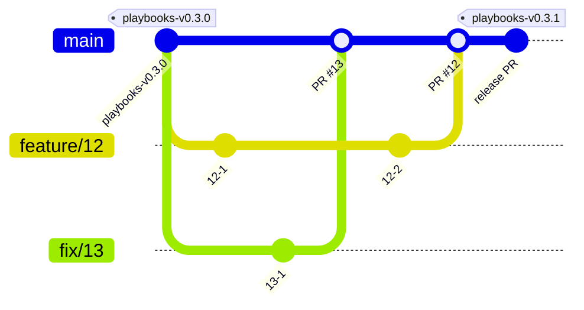
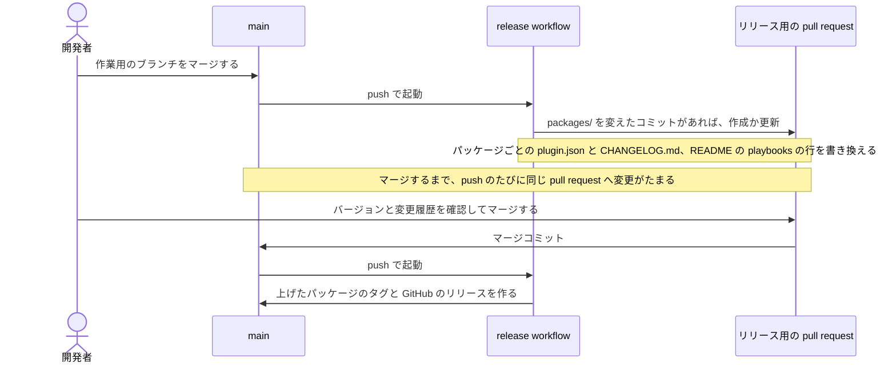

# 開発の準備

必要なものは mise である。Node.js、pnpm、apm のバージョンは `mise.toml` にある。

```sh
mise install
pnpm install
```

`pnpm install` は、`prepare` で lefthook の Git のフックを入れる。

スキルとフックは apm で配置し、Git で追跡しない。clone した後の最初のセッションで、セッションの開始のフックが配置する。手で配置するときは次を実行する。

```sh
apm install --frozen
```

`apm install` の後に配置先を `.gitignore` に足す post-install は、マシンごとに 1 度信頼させる。

```sh
apm lifecycle trust
```

## 文書を直すとき

文章の規則は textlint で、経緯の混入とリンクは docs のスクリプトで確認する。指摘された語は言い換え、`--fix` は使わない。パッケージのスキルと playbook も、同じ規則で書く。

```sh
pnpm exec textlint <直した Markdown>
node .claude/hooks/docs/hooks/check-history.mjs
node .claude/hooks/docs/hooks/check-links.mjs
```

## パッケージを直すとき

- スキルの書き方は、スキル write-skill に従う。`SKILL.md` は 150 行以内に保つ。
- パッケージは playbooks、sessions、review の 3 つで、置くものは [Design Doc の Architecture](design/DesignDoc.md#architecture) にある。sessions は playbooks に依存し、ほかの向きの依存を作らない。
- playbook を足すときは、置き場の playbook のディレクトリに `<名前>.md` を作り、その索引のスキルに 1 行を足す。
  - 工程の作業は `packages/playbooks/skills/run-playbook/playbooks/` に置く。
  - 1 回の会話を超える作業は `packages/sessions/skills/run-session/playbooks/` に置く。
- principle は `packages/playbooks/skills/run-playbook/principles/<名前>.md` に置き、run-playbook の索引に足す。
- playbook を足したときは、`evals/run-playbook.json` に、その playbook が選ばれるべき依頼を 1 つ足し、`scripts/eval-run-playbook.mjs` の名前の一覧に足す。
- 直したパッケージを、評価で確認する。仮の利用者に 3 つのパッケージを入れ、依頼ごとに期待した playbook が選ばれるかを、モデルごとに試す。モデルを実際に動かすので、使うモデルを絞って実行してよい。

```sh
node scripts/eval-run-playbook.mjs            # haiku、sonnet、opus で試す
node scripts/eval-run-playbook.mjs sonnet     # 1 つのモデルで試す
```

## コミットするとき

コミットの前に、lefthook が次を確認する。設定は `lefthook.yml` にある。

- ステージした Markdown に textlint を掛ける。
- commit-msg のフックで、commitlint がメッセージの形式を確認する。規則は `commitlint.config.mjs` にある。

- 変更の分け方とメッセージの書き方は、スキル write-commit に従う。

## ブランチとリリース

ブランチは、main と、作業用のブランチだけにする。

- 作業用のブランチの名前は `feature/<issue 番号>` にする。不具合の issue は `fix/<issue 番号>` にする。issue のない作業は `feature/<主題>` にする。
- main へは、pull request を通してマージする。マージの方法はマージコミットにする。
- 保護するブランチは `main` である。直接コミットを許す場面があれば、この行の下に場面と理由を書く。

次の図は、作業用のブランチを main へマージし、リリース用の pull request でタグを付けるまでの流れを示す。



バージョンは、セマンティック バージョニングに従う。パッケージごとにバージョンを付け、タグは `<パッケージ名>-v<バージョン>` の形にする。`v0.2.3` までの `v<バージョン>` のタグは、パッケージを分ける前のもので、消さずに残す。  
1.0 より前は、破壊的な変更で minor を、それ以外で patch を上げる。

- 出典: [Semantic Versioning 2.0.0](https://semver.org/lang/ja/)

バージョンの決定とタグ付けには release-please を使う。コミットメッセージから次のバージョンを決め、リリース用の pull request を作る。  
リリース用の pull request をマージすると、タグとリリースができる。

- ADR-0011: [release-please でパッケージごとにタグを付け、変えたパッケージのバージョンだけを上げる](adr/0011-per-package-release.md)

バージョンが上がるのは、`packages/<パッケージ名>/` の下を変えたコミットがあるパッケージだけ。コミットの type と、上がるバージョンの桁の対応は次のとおり。

| コミットの type | 1.0 より前 | 1.0 以降 | 変更履歴のセクション |
| --- | --- | --- | --- |
| type の後に `!`、または本文に `BREAKING CHANGE:` | minor | major | BREAKING CHANGES |
| `feat` | patch | minor | Features |
| `fix` | patch | patch | Bug Fixes |
| `perf`、`revert`、`docs` | patch | patch | 各 type のセクション |
| `chore`、`refactor`、`test`、`build`、`ci`、`style` | patch | patch | 載らない |

- 変更履歴に載るコミットが 1 つもないと、リリース用の pull request は作られない。
- 次の変更は、利用者の呼び方や手順が変わるので破壊的な変更とする。type の後に `!` を付け、本文に `BREAKING CHANGE:` を書く。
  - スキルの改名と削除
  - playbook の改名と削除
  - playbook とスキルのパッケージの間の移動
  - 前提にする agent-harness のバージョンを上げること
- マージした変更を取り消すときは、取り消すコミットの type と scope を引き継ぎ、`revert(<scope>): <要約>` の形で書く。タグとリリースは消さず、付け替えない。

### リリースの流れ

main へ push するたびに、`.github/workflows/release.yml` がリリース用の pull request を作るか更新する。  
リリース用の pull request は常に 1 つで、マージするまで変更がたまる。タグとリリースができるのは、この pull request をマージしたときだけである。

次の図は、作業用のブランチをマージしてから、タグとリリースができるまでの流れを示す。



リリースするときは、次の順に進める。

1. リリース用の pull request を開き、パッケージごとのバージョンと `packages/<パッケージ名>/CHANGELOG.md` の変更を確認する。
2. sessions か review のバージョンが上がるときは、README の導入の例の、そのパッケージの行のタグを、リリース用の pull request のブランチで手で直す。release-please が書き換えるのは playbooks の行だけである。
3. 最新のコミットの CI が通っていることを確認する。
4. マージコミットでマージする。
5. release workflow が終わったら、`gh release view <パッケージ名>-v<バージョン>` でタグとリリースができたことを確認する。
6. release workflow が失敗したときは、GitHub の Actions の画面で、失敗した実行をやり直す。

## issue と pull request

- 作業は issue から始める。pull request は 1 つの issue に対応させる。
  - issue は、issue テンプレートの要求、不具合と、設計、実装、検証、文書の 4 つのタスクから選ぶ。
  - 要求は、テンプレートの「種別」で、`context/project.yml` の `process.presets` の種別を 1 つ選ぶ。種別で、行うプロセスと、子のタスクの種類が決まる。
- 種類のラベルは、テンプレートが付ける。

  | 種類 | ラベル |
  | --- | --- |
  | 要求 | `type:requirements` |
  | 不具合 | `type:bug` |
  | 設計のタスク | `type:design` |
  | 実装のタスク | `type:impl` |
  | 検証のタスク | `type:verify` |
  | 文書のタスク | `type:docs` |

- 題と本文の書き方は、スキル write-issue-pr に従う。
