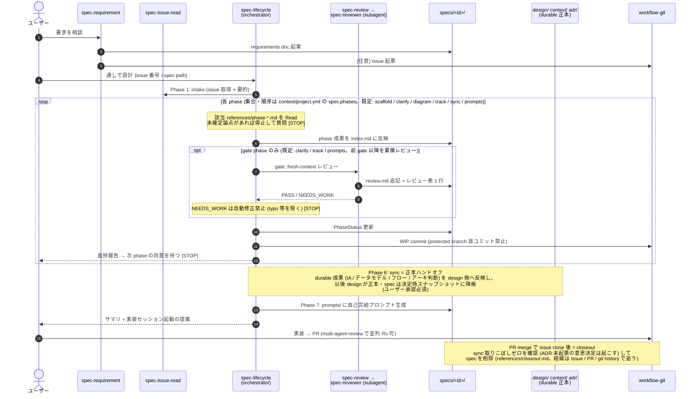

# Architecture — skill 連鎖の俯瞰

要求が挙がってから実装 prompt が生成されるまで、どの skill が・いつ・どの文書を触り・どの状態を遷移させるかの唯一の俯瞰図。

> **メンテ必須**: skill の連鎖挙動 (呼び出し関係・phase gate・PhaseStatus の増減 / 遷移・正本ハンドオフのタイミング) を変えたら、**同 PR で本シーケンスと遷移表を必ず更新する** (`Skill 共通契約`)。図が実 skill とズレると、全体像の唯一の俯瞰図が腐り誤った前提で逆戻しされる。

構成要素の正本: 全プロジェクト共通の workflow skill は `.rulesync/skills/`、選択導入型 skill は `skills/`、レビュー観点は `.rulesync/subagents/spec-reviewer.md`、運用ルールは `.rulesync/rules/CLAUDE.md` の `Spec Workflow Contract` (AGENTS.md はその生成物)、プロジェクト固有値は `context/project.yml`。

## 要求 → 実装 prompt 生成の全体シーケンス

- `[STOP]` = ユーザーの承認・判断まで skill が停止するゲート。承認の取り方 (3 択以上・既定を進める側にしない) は contract の「承認の取り方」。
- issue 側の進捗要約は `status:*` ラベル + 状態遷移コメント (`workflow-git` の `issue-status.md` が正本): scaffold 開始 → `designing`、最終 gate レビュー済 → `ready-to-implement`、実装 prompt ステップ 0 → `implementing`、PR の `Closes #N` で close。個人利用前提のためイベント記録 (リードタイム計測) は持たない。
- intake は入力を `intake-checklist` で **受け入れ再検証** し、欠落があれば `spec-requirement` へ差し戻す (作成時の自己申告を信用しない)。
- scaffold で **増分判定** した spec は、clarify 冒頭で **実装との突合ゲート** (spec × 実装 × ADR × context) を通し、食い違いはユーザーが正を確定する。prompts は **生成モード判定** (新規実装 / 差分修正) で既存資産との衝突を防ぐ。
- どの phase でも **前段の取りこぼし (要求漏れ / 設計漏れ)** を検知したら、進行中 spec に吸収せず派生 issue (`quality:*` ラベル) を起票する (`workflow-git` の `derived-issue.md`)。
- レビュー観点の正本は subagent 定義に一元化: spec / 文書 = `spec-reviewer` (Default-FAIL)、コード差分 = `review-{architecture,quality,security,performance}` (敵対的姿勢: 好意的解釈をせず、迷ったら指摘に倒す)。
- 実装後のクロスチェックは `multi-agent-review` (基盤は `agent-orchestrate`)。コード差分は `review-routing.md` の表で観点を選び、外部 CLI 不在時は Claude の `review-*` subagent に degrade して観点別レビューだけは回す。

## PhaseStatus (設計フェーズ状況) の遷移

spec の `## 設計フェーズ状況` 表が各 phase の状態を管理する。遷移は `spec-lifecycle` のみが行う。

| 遷移                  | タイミング                                          |
| --------------------- | --------------------------------------------------- |
| `未着手` → `進行中`   | phase 作業開始時                                    |
| `進行中` → `完了`     | phase 成果の反映完了時 (非 gate phase はここが終端) |
| `完了` → `レビュー済` | gate phase で `spec-review` PASS + 指摘対応完了時   |
| 任意 → `保留`         | ユーザー判断待ち (備考に理由必須)                   |
| `保留` → `進行中`     | 備考の解消をユーザーに確認できたとき                |

再開規則 (`spec-lifecycle` 事前確認): `進行中` はその phase から、`完了` は gate phase ならレビュー未了扱いで同 phase の review から (非 gate phase は次 phase へ)、`未着手` は直近の未着手から再開する。

## 知見と修正の書き戻し経路

作業で得たものを会話の中で終わらせず、正しい正本に書き戻すための 3 経路。

- **設計の決定**: spec で確定した durable 成果は sync phase で design / context / ADR へ (上記シーケンスに内蔵)。選択肢を比較して決めた判断は ADR 化が既定 (`phase-sync.md`)。spec は issue close 時に削除されるため、sync が唯一の救出点。
- **横断的な知見** (ハマりどころ / 暗黙の仕様 / 規約の欠落): `context-harvest` skill で `context/` / feature doc / ADR に書き戻す。
- **skill 自体の不具合**: 製品フローと直交するため `skill-feedback` skill で `.rulesync/` 正本を修正 → `rulesync-sync` で再生成 → `make check`。非自明な判断は [decisions.md](decisions.md) に記録する。

PR レビュー (`multi-agent-review`) の指摘は、投稿したレポートに「対応した / 対応しない (理由) / 後続対応 (行き先)」の対応記録を残して消化する (`multi-agent-review` の `references/pr-comment.md`)。
