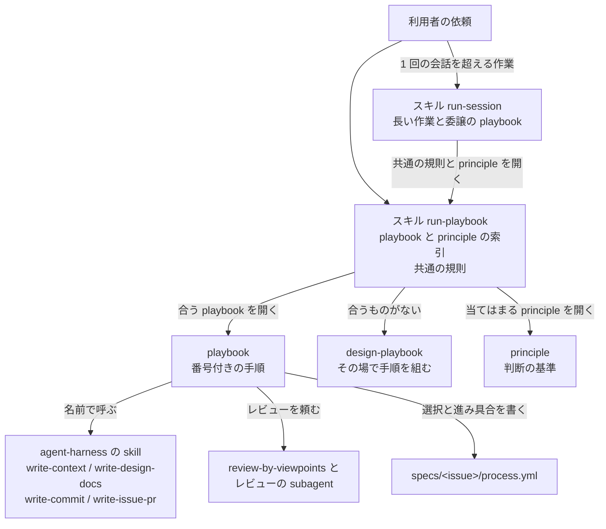

# agent-playbooks Design Doc

## Overview

agent-playbooks は、コーディングエージェントが作業をどの順に進めるかを、playbook として配るパッケージ群である。  
agent-harness が定める開発プロセスの標準の上で動く、具体のワークフローのハーネスに当たる。

利用者は、agent-harness の core と docs を入れたリポジトリに、このリポジトリのパッケージを足して使う。  
依頼を受けたエージェントが索引のスキル run-playbook か run-session を読み、依頼に合う playbook を選び、その手順に沿って作業する。

構成は pstack に倣う。

- [cursor/plugins の pstack](https://github.com/cursor/plugins/tree/main/pstack)

## Goals and Non-Goals

### Goals

- 依頼の種類ごとに、作業の手順を playbook として持つ。手順は番号付きで、各手順から skill と principle を名前で呼ぶ。
- パッケージごとの索引のスキルが playbook の索引を持ち、依頼から playbook を選ぶ。利用者は playbook の名前を覚えなくてよい。
- 合う playbook がない作業では、その場で手順を組む。
- 手順の途中の判断の基準を、principle として少数持つ。
- 作業の進み具合を、agent-harness の `process.yml` に記録する。

### Non-Goals

- 作業を次へ進める実行エンジン。手順はエージェントが todolist に写して進める。ワーカーを立ち上げ、完了を確認してマージする手順も、エージェントが自分で進め、状態は引き継ぎのメモとリポジトリにだけ置く。
  - ADR-0007: [事前の権限は委任のセクションか利用者の個人の常設の指示に書いたときだけ使い、再開のメモ、判断の記録、動いているものを主題のディレクトリの引き継ぎのメモにまとめる](../adr/0007-pre-granted-permission-and-handoff-memo-placement.md)
- context、文書の型、commit と issue と PR の規約。agent-harness の core と docs が持つ。
- 利用者のリポジトリだけの取り決め。利用者の context に置く。

## Assumptions and Constraints

- 利用者は、agent-harness の core（`core-v0.2.12` 以上）と docs（`docs-v0.2.14` 以上）を入れている。playbook は、core と docs の skill を名前で呼ぶ。
- agent-harness の製品のパッケージ（verification、e2e、screens、design-system、docs-site）は任意である。playbook は、製品のパッケージの skill も名前で呼ぶ。skill が配置されていない段は、todolist に `skip: <パッケージ名> のパッケージが無い` と残して飛ばす。
  - ADR-0005: [playbook から agent-harness の製品のパッケージのスキルを名前で呼び、入っていないパッケージの段は飛ばす](../adr/0005-call-product-package-skills-by-name.md)
- 利用者の個人の構成の skill は、名前で呼ばない。
- 配布は apm で行い、Claude Code と Codex CLI に配置する。形は Claude Code の形式のプラグインにする。
- agent-harness の process のパッケージ（`process.yml` の schema とチェック）はまだない。playbook は、agent-harness の開発プロセスの Design Doc が定める形で `process.yml` を書く。schema のチェックは、process のパッケージができたら使う。

## Architecture

パッケージは、変わる理由ごとに 3 つに分ける。

- ADR-0008: [パッケージを、工程の playbooks、長い作業と委譲の sessions、レビューの review の 3 つに分ける](../adr/0008-split-into-playbooks-sessions-review.md)

| パッケージ | 持つもの | 依存 |
| --- | --- | --- |
| playbooks | 索引のスキル run-playbook、工程の playbook、principle、共通の規則、スキル design-playbook | なし |
| sessions | 索引のスキル run-session、長い作業と委譲の playbook、引き継ぎのメモとワーカーへの指示の形 | playbooks の共通の規則と principle を名前で開く |
| review | スキル review-by-viewpoints と、5 つのレビューの subagent | なし |

- playbooks の手順が sessions の playbook か review のスキルを挙げる段は、そのパッケージが入っていなければ、todolist に `skip: <パッケージ名> のパッケージが無い` と残して飛ばす。review が無いときは、差分を自分で読み直す。
- sessions は共通の規則を写さない。同じ規則を 2 つのパッケージに書くと、片方だけが更新されて食い違うためである。

次の図は、利用者のリポジトリで、エージェントが playbook を選んで作業を進めるときの要素の関係を示す。



## Components

### スキル run-playbook

- playbook の索引を持つ。項目ごとに、名前と、どんな依頼に当てはまるかを 1 行で書く。
- すべての playbook に共通する規則を持つ。todolist の作り方、作業の前に読むもの、判断の 3 段、論点の尋ね方、返答の形。
- 場面を選んで読む規則（事前の権限、判断の記録、ワーカーとサブエージェント）は `rules/<名前>.md` に置き、規則の索引に読む場面を書く。SKILL.md を 150 行以内に保つためである。
- playbook の索引は、工程ごとのまとまり（要求と設計、実装、確認、pull request、学び）に並べる。
- principle の索引を持つ。当てはまる principle だけを全文読ませる。
- playbook、principle、場面で読む規則の本文は持たない。`playbooks/<名前>.md`、`principles/<名前>.md`、`rules/<名前>.md` に置き、選んだものだけを開く。
- playbook の手順が別の playbook や principle の名前を挙げたときも、この索引から開かせる。参照を SKILL.md から 1 段に保つためである。

### スキル run-session

- パッケージ sessions の、長い作業と委譲の playbook の索引を持つ。
- 共通の規則と principle は持たず、スキル run-playbook から開く。
- playbook の本文は `playbooks/<名前>.md` に置き、選んだものだけを開く。
- ADR-0009: [パッケージごとの索引のスキルが playbook の索引を持ち、playbook と principle と場面で読む規則はファイルとして置く](../adr/0009-entry-skills-with-playbook-files.md)

### playbook

frontmatter を持たない Markdown で、索引のスキル（run-playbook か run-session）の `playbooks/` に置く。単独では読み込まれない。  
中身は次の 4 つ。

- 担当の範囲。この playbook が何に責任を持ち、隣の playbook と何が違うか。
- 番号付きの手順。各手順から skill と principle を名前で呼ぶ。
- 止まる条件。人の判断を待つ場面。
- 返答に書くこと。

playbook は次のとおり。

| playbook | パッケージ | 当てはまる依頼 | 主に行う開発プロセス |
| --- | --- | --- | --- |
| requirements | playbooks | 実現したいことを整理して issue にする | requirements |
| feature | playbooks | 振る舞いを足すか変える | requirements から integration |
| prototype | playbooks | 使い捨ての実装で、設計の判断や、実行すれば分かる問いに答える | design |
| bug-fix | playbooks | 報告された不具合を再現し、原因を突き止めて直す | implementation、verification |
| refactoring | playbooks | 振る舞いを変えずに、構造を変える | implementation、verification |
| small-change | playbooks | 設計の判断が要らない小さな変更 | implementation、integration |
| investigation | playbooks | コードを変えずに問いに答える | なし |
| opening-a-pr | playbooks | 変更を pull request にする。ほかの playbook の最後に呼ぶ | integration |
| pr-follow-up | playbooks | pull request のレビューの指摘と CI の失敗に対応する | integration |
| verification-setup | playbooks | アプリを利用者と同じ方法で動かして確認する手段を作り、保つ | verification-design |
| reflect | playbooks | 終えた作業から学びを取り出し、context か配布元へ書き戻す | なし |
| correct | playbooks | 繰り返す誤りを、仕組みで起こせなくする | implementation |
| autonomous-run | sessions | 決めた終了の条件まで、止まらずに進める | 組んだ手順による |
| pause-safely | sessions | 作業を、続きから再開できる形で止める | なし |
| session-pickup | sessions | 前の作業を、続きから再開する | 引き継いだ作業による |
| delegate-work | sessions | 作業を別のセッションに渡す | なし |
| coordinate-workers | sessions | 依存を並べた複数の作業をワーカーに配り、マージと片付けまで繰り返す | integration |

### design-playbook

合う playbook がない作業と、範囲が大きい作業で使う。利用者が離れている間の作業は sessions の autonomous-run が受け、手順が決まっていなければ design-playbook で組む。  
終了の条件、範囲、確認の方法を先に決め、作業を単独でマージできる単位に分け、その場の手順を組む。組んだ手順は保存しない。

### principle

手順の途中の判断の基準を 1 つずつ書いた Markdown で、スキル run-playbook の `principles/` に置く。skill にはせず、run-playbook の索引から読まれる。  
次の 5 つを持つ。

- prove-it-works: 本物で動かして確認してから、終わったと言う。
- fix-root-causes: 症状を隠さず、再現してから原因を直す。
- smallest-change: 問題を解く最小の変更を選ぶ。
- encode-lessons: 2 回した訂正は、文章ではなくチェックや仕組みに移す。
- bound-every-wait: 外部の待ちに上限を付け、上限を超えたら代わりの根拠で進めるか止まり、待たずに進めたことを記録する。

### review-by-viewpoints とレビューの subagent

パッケージ review に置き、ほかのパッケージに依存しない。差分か spec を、観点ごとの subagent に読ませ、指摘を重大度の順にまとめる。subagent は読み取りだけを行う。  
観点は、アーキテクチャ、性能、品質、セキュリティ、spec の 5 つである。

## Interfaces

### 導入

利用者は、`apm.yml` に agent-harness の core と docs と並べて、使うパッケージを書く。製品のパッケージは、要るものだけを足す。タグは、agent-harness もこのリポジトリも、パッケージごとの `<名前>-v<バージョン>` の形で書く。

```yaml
dependencies:
  apm:
    - Fukuemon/agent-harness/packages/core#core-v0.2.12
    - Fukuemon/agent-harness/packages/docs#docs-v0.2.14
    - Fukuemon/agent-harness/packages/verification#verification-v0.3.1 # 任意
    - Fukuemon/agent-playbooks/packages/playbooks#playbooks-v<バージョン>
    - Fukuemon/agent-playbooks/packages/sessions#sessions-v<バージョン> # 任意。playbooks を前提にする
    - Fukuemon/agent-playbooks/packages/review#review-v<バージョン> # 任意
```

### 呼び方

- 利用者は `/run-playbook` に依頼を添えて呼ぶ。1 回の会話を超える作業は `/run-session` で呼ぶ。索引のスキルが playbook を選ぶ。依頼の内容から、スキルが自動で読み込まれることもある。
- 利用者が playbook の名前を添えたときは、その playbook を使う。

### 利用者のリポジトリに置かれるファイル

- `specs/<issue 番号>-<主題>/process.yml`: feature と requirements の playbook が書く。形は agent-harness の開発プロセスの Design Doc に従う。

## Cross-Cutting Concerns

### 進み具合の記録

- 通常の作業では、進み具合をファイルに残さない。エージェントが playbook の手順を todolist に写し、飛ばす手順にも `skip: <理由>` を付けて残す。
- spec を置く作業だけ、`process.yml` に選んだプロセスと進み具合を書く。
- コンテキストの使用量の知らせを受けたときは、pause-safely で引き継ぎのメモを書く。閾値と知らせの手段は、利用者の構成に任せる。ワーカーは次のセッションを自分で起動せず、親に知らせて止まる。親は delegate-work で次の親に渡す。
- 作業を中断するとき、別のセッションに渡すときは、リポジトリの主の作業ツリーの `.ai-out/<主題>/YYYY-MM-DD-<主題>-handoff.md` の引き継ぎのメモに書く。ワーカーには絶対パスで渡す。再開のメモ、判断の記録、動いているものは、このメモのセクションにする。
  - ADR-0007: [事前の権限は委任のセクションか利用者の個人の常設の指示に書いたときだけ使い、再開のメモ、判断の記録、動いているものを主題のディレクトリの引き継ぎのメモにまとめる](../adr/0007-pre-granted-permission-and-handoff-memo-placement.md)
- 引き継ぎのメモのセクションは、委任、最初に読むもの、今の状態、動いているもの、作るもの、進め方、ほかの作業との順番、守ること、進み具合、返事待ち、決まったこと、次にすること、結果。
  - 動いているものには、起動したワーカーとその端末を読む手段で使う識別子、実行中の処理の ID、外部の待ちとその上限の時刻を書く。
  - 書き直してよいセクションは、今の状態、動いているもの、返事待ちだけ。進み具合と決まったことは追記だけにする。
  - 次にすることは、済んだ項目に印を付けて消さない。
- 受け取る側は、会話の要約より先に引き継ぎのメモを読む。

### 止まって尋ねる場面

- 元に戻せる作業は、尋ねずに進めて結果を見せる。
- 作業の中の判断は、3 段に分けて扱う。
  - ADR-0006: [作業の中の判断を、推奨で決めて進める、尋ねて進める、止まるの 3 段に分け、論点の尋ね方を 1 つにする](../adr/0006-three-tiers-of-decisions.md)
  - 見た目、文言、内部の命名のような、後から戻せる小さな判断は、推奨の案で決めて進め、判断の記録に残し、区切りでまとめて伝える。委任のセクションに利用者が判断の種類を並べたときだけ、この範囲を広げる。
  - issue と設計の文書に無い動き、業務の語、権限、データの扱い、範囲、優先順位は、決めずに尋ねる。答えを待つ間は、その論点に依存しない作業を進め、依存する作業しか残らなければ止まる。
  - 尋ねる論点は、選択肢（2〜4）、推奨と理由、決まらないと進めない作業の形で書き、引き継ぎのメモの「返事待ち」にも残す。
- push、pull request のマージ、デプロイ、データの削除と取り消せない変更、外部への送信の前では止まる。
  - push は、作業用のブランチへの push も、pull request を開く前か後かを問わず含む。
  - 外部への送信は、issue と pull request の作成と書き換えを含む。
- 実行すれば分かる事実は、尋ねずに確認する。
- 引き継ぎのメモの委任のセクションか、利用者の個人の常設の指示に、範囲、対象、与えた人と日付がそろっていれば、範囲に並べた操作の前では止まらない。範囲に並べられる操作は、作業用のブランチへの push、issue と pull request の作成と書き換え、マージ、マージしたブランチと worktree の片付け。
  - ADR-0007: [事前の権限は委任のセクションか利用者の個人の常設の指示に書いたときだけ使い、再開のメモ、判断の記録、動いているものを主題のディレクトリの引き継ぎのメモにまとめる](../adr/0007-pre-granted-permission-and-handoff-memo-placement.md)
- 範囲に並べた片付け以外のデータの削除、取り消せない変更、デプロイ、範囲に並べた操作以外の外部への送信は、委任のセクションや常設の指示があっても止まる。
- リポジトリの context は、委任の範囲を狭めるときにだけ使う。context に権限を書いても、止まる場面は外れない。
- 事前の権限は、別のセッションとして立ち上げたワーカーにだけ、委任のセクションで渡す。セッションの中から起動するサブエージェントには渡さない。

### 確認する手段

- 「本物で確認する」手順は、利用者のリポジトリの `context/testing/verification.md` の手順で動かす。この文書とスクリプトは、利用者のリポジトリだけの知識なので、スキルではなく context と `scripts/verify/` に置く。verification-setup が作り、保つ。

### 判断の記録

- 長い作業と、利用者が離れている間の作業では、分かれ道の判断を、引き継ぎのメモの「決まったこと」のセクションに 1 行ずつ追記する。形はスキル run-playbook の `rules/decision-log.md` が持つ。

### 学びの書き戻し

- 同じ訂正を 2 回したら、principle の encode-lessons に従い、チェックか仕組みに移す。手順は correct が、作業の後の振り返りは reflect が持つ。
- playbook と skill の誤りは、作業の途中でも、別の pull request で直す。

## Repository Layout

```text
agent-playbooks/
├── .claude-plugin/
│   └── marketplace.json       パッケージの一覧
├── packages/
│   ├── playbooks/
│   │   ├── .claude-plugin/plugin.json
│   │   └── skills/
│   │       ├── run-playbook/
│   │       │   ├── SKILL.md    playbook と principle の索引、共通の規則
│   │       │   ├── playbooks/  工程の playbook の本体
│   │       │   ├── rules/      場面で読む規則の本体
│   │       │   └── principles/ principle の本体
│   │       └── design-playbook/
│   ├── sessions/
│   │   ├── .claude-plugin/plugin.json
│   │   └── skills/run-session/
│   │       ├── SKILL.md        長い作業と委譲の playbook の索引
│   │       └── playbooks/      長い作業と委譲の playbook の本体
│   └── review/
│       ├── .claude-plugin/plugin.json
│       ├── skills/review-by-viewpoints/
│       └── agents/            レビューの subagent
├── evals/
│   └── run-playbook.json    依頼と、選ばれるべき playbook
├── scripts/
│   └── eval-run-playbook.mjs 評価を実行する
├── design/
│   └── DesignDoc.md
├── adr/
├── context/
├── apm.yml                    このリポジトリが使う agent-harness
└── README.md
```
