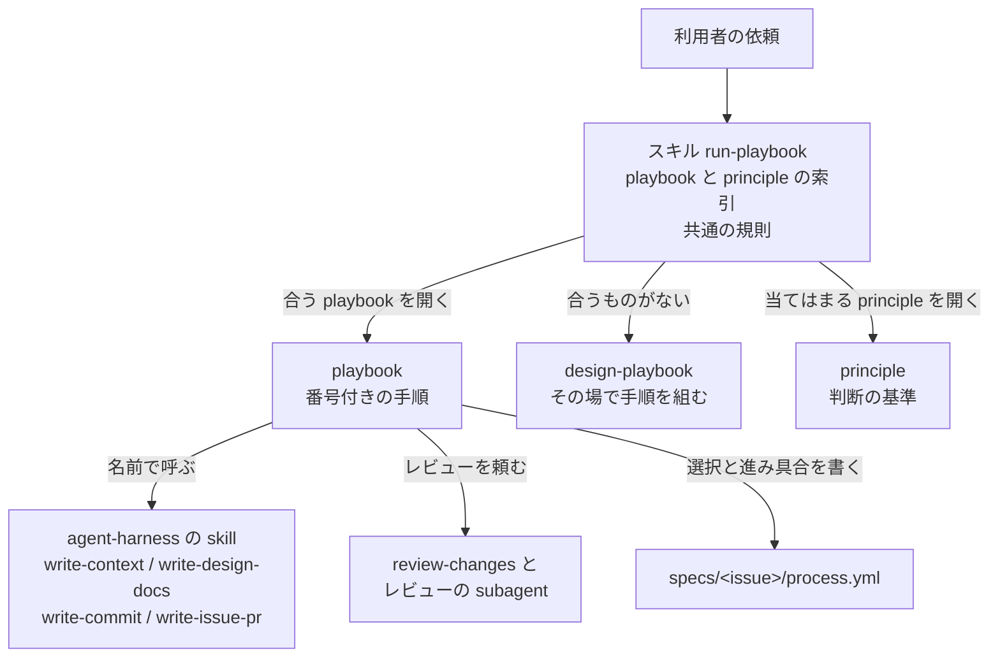

# agent-playbooks Design Doc

## Overview

agent-playbooks は、コーディングエージェントが作業をどの順に進めるかを、playbook として配るパッケージである。  
agent-harness が定める開発プロセスの標準の上で動く、具体のワークフローのハーネスに当たる。

- agent-harness の ADR-0008: [開発プロセスの標準はこのリポジトリに置き、具体のワークフローのハーネスは別のリポジトリに置く](https://github.com/Fukuemon/agent-harness/blob/v0.2.1/adr/0008-workflow-harness.md)

利用者は、agent-harness の core と docs を入れたリポジトリに、このパッケージを足して使う。  
依頼を受けたエージェントがスキル run-playbook を読み、依頼に合う playbook を選び、その手順に沿って作業する。

構成は pstack に倣う。

- [cursor/plugins の pstack](https://github.com/cursor/plugins/tree/main/pstack)

## Goals and Non-Goals

### Goals

- 依頼の種類ごとに、作業の手順を playbook として持つ。手順は番号付きで、各手順から skill と principle を名前で呼ぶ。
- スキル run-playbook が playbook の索引を持ち、依頼から playbook を選ぶ。利用者は playbook の名前を覚えなくてよい。
- 合う playbook がない作業では、その場で手順を組む。
- 手順の途中の判断の基準を、principle として少数持つ。
- 作業の進み具合を、agent-harness の `process.yml` に記録する。

### Non-Goals

- 作業を次へ進める実行エンジン。手順はエージェントが todolist に写して進める。ワーカーを立ち上げ、完了を確認してマージする手順も、エージェントが自分で進め、状態は引き継ぎのメモとリポジトリにだけ置く。
  - ADR-0004: [事前の権限は引き継ぎのメモの委任の節か、利用者の個人の常設の指示に書いたときだけ使い、再開のメモと判断の記録を引き継ぎのメモにまとめる](../adr/0004-pre-granted-permission-and-handoff-memo.md)
- context、文書の型、commit と issue と PR の規約。agent-harness の core と docs が持つ。
- 利用者のリポジトリだけの取り決め。利用者の context に置く。

## Assumptions and Constraints

- 利用者は、agent-harness v0.2.1 以上の core と docs を入れている。playbook は、core と docs の skill を名前で呼ぶ。
- 配布は apm で行い、Claude Code と Codex CLI に配置する。形は Claude Code の形式のプラグインにする。
- agent-harness の process のパッケージ（`process.yml` の schema とチェック）はまだない。playbook は、agent-harness の開発プロセスの Design Doc が定める形で `process.yml` を書く。schema のチェックは、process のパッケージができたら使う。

## Architecture

次の図は、利用者のリポジトリで、エージェントが playbook を選んで作業を進めるときの要素の関係を示す。



## Components

### スキル run-playbook

- playbook の索引を持つ。項目ごとに、名前と、どんな依頼に当てはまるかを 1 行で書く。
- すべての playbook に共通する規則を持つ。todolist の作り方、止まって尋ねる場面、返答の形。
- principle の索引を持つ。当てはまる principle だけを全文読ませる。
- playbook と principle の本文は持たない。`playbooks/<名前>.md` と `principles/<名前>.md` に置き、選んだものだけを開く。
- playbook の手順が別の playbook や principle の名前を挙げたときも、この索引から開かせる。参照を SKILL.md から 1 段に保つためである。

### playbook

frontmatter を持たない Markdown で、スキル run-playbook の `playbooks/` に置く。単独では読み込まれない。  
中身は次の 4 つ。

- 担当の範囲。この playbook が何に責任を持ち、隣の playbook と何が違うか。
- 番号付きの手順。各手順から skill と principle を名前で呼ぶ。
- 止まる条件。人の判断を待つ場面。
- 返答に書くこと。

playbook は次のとおり。

| playbook | 当てはまる依頼 | 主に行う開発プロセス |
| --- | --- | --- |
| requirements | 実現したいことを整理して issue にする | requirements |
| feature | 振る舞いを足すか変える | requirements から integration |
| prototype | 使い捨ての実装で、設計の判断や、実行すれば分かる問いに答える | design |
| bug-fix | 報告された不具合を再現し、原因を突き止めて直す | implementation、verification |
| refactoring | 振る舞いを変えずに、構造を変える | implementation、verification |
| small-change | 設計の判断が要らない小さな変更 | implementation、integration |
| investigation | コードを変えずに問いに答える | なし |
| opening-a-pr | 変更を pull request にする。ほかの playbook の最後に呼ぶ | integration |
| pr-follow-up | pull request のレビューの指摘と CI の失敗に対応する | integration |
| verification-setup | アプリを利用者と同じ方法で動かして確認する手段を作り、保つ | verification-design |
| reflect | 終えた作業から学びを取り出し、context か配布元へ書き戻す | なし |
| correct | 繰り返す誤りを、仕組みで起こせなくする | implementation |
| autonomous-run | 決めた終了の条件まで、止まらずに進める | 組んだ手順による |
| pause-safely | 作業を、続きから再開できる形で止める | なし |
| session-pickup | 前の作業を、続きから再開する | 引き継いだ作業による |
| delegate-work | 作業を別のセッションに渡す | なし |
| coordinate-workers | 依存を並べた複数の作業をワーカーに配り、マージと片付けまで繰り返す | integration |

### design-playbook

合う playbook がない作業と、範囲が大きい作業で使う。利用者が離れている間の作業は autonomous-run が受け、手順が決まっていなければ design-playbook で組む。  
終了の条件、範囲、確認の方法を先に決め、作業を単独でマージできる単位に分け、その場の手順を組む。組んだ手順は保存しない。

### principle

手順の途中の判断の基準を 1 つずつ書いた Markdown で、スキル run-playbook の `principles/` に置く。skill にはせず、run-playbook の索引から読まれる。  
次の 5 つを持つ。

- prove-it-works: 本物で動かして確認してから、終わったと言う。
- fix-root-causes: 症状を隠さず、再現してから原因を直す。
- smallest-change: 問題を解く最小の変更を選ぶ。
- encode-lessons: 2 回した訂正は、文章ではなくチェックや仕組みに移す。
- bound-every-wait: 外部の待ちに上限を付け、上限を超えたら代わりの根拠で進めるか止まり、待たずに進めたことを記録する。

### review-changes とレビューの subagent

差分か spec を、観点ごとの subagent に読ませ、指摘を重大度の順にまとめる。subagent は読み取りだけを行う。  
観点は、アーキテクチャ、性能、品質、セキュリティ、spec の 5 つである。

## Interfaces

### 導入

利用者は、`apm.yml` に agent-harness の core と docs と並べて、このパッケージを書く。

```yaml
dependencies:
  apm:
    - Fukuemon/agent-harness/packages/core#v0.2.1
    - Fukuemon/agent-harness/packages/docs#v0.2.1
    - Fukuemon/agent-playbooks/packages/playbooks#<ref>
```

### 呼び方

- 利用者は `/run-playbook` に依頼を添えて呼ぶ。スキル run-playbook が playbook を選ぶ。依頼の内容から、スキルが自動で読み込まれることもある。
- 利用者が playbook の名前を添えたときは、その playbook を使う。

### 利用者のリポジトリに置かれるファイル

- `specs/<issue 番号>-<主題>/process.yml`: feature と requirements の playbook が書く。形は agent-harness の開発プロセスの Design Doc に従う。

## Cross-Cutting Concerns

### 進み具合の記録

- 通常の作業では、進み具合をファイルに残さない。エージェントが playbook の手順を todolist に写し、飛ばす手順にも `skip: <理由>` を付けて残す。
- spec を置く作業だけ、`process.yml` に選んだプロセスと進み具合を書く。
- 作業を中断するとき、別のセッションに渡すときは、リポジトリの主の作業ツリーの `.ai-out/YYYY-MM-DD-<主題>-handoff.md` の引き継ぎのメモに書く。ワーカーには絶対パスで渡す。再開のメモと判断の記録は、このメモのセクションにする。
  - ADR-0004: [事前の権限は引き継ぎのメモの委任の節か、利用者の個人の常設の指示に書いたときだけ使い、再開のメモと判断の記録を引き継ぎのメモにまとめる](../adr/0004-pre-granted-permission-and-handoff-memo.md)
- 引き継ぎのメモのセクションは、委任、最初に読むもの、今の状態、作るもの、進め方、ほかの作業との順番、守ること、進み具合、返事待ち、決まったこと、次にすること、結果。
  - 書き直してよいセクションは、今の状態と返事待ちだけ。進み具合と決まったことは追記だけにする。
  - 次にすることは、済んだ項目に印を付けて消さない。
- 受け取る側は、会話の要約より先に引き継ぎのメモを読む。

### 止まって尋ねる場面

- 元に戻せる作業は、尋ねずに進めて結果を見せる。
- push、pull request のマージ、デプロイ、データの削除と取り消せない変更、外部への送信の前と、利用者だけが決められる判断では止まる。
  - push は、作業用のブランチへの push も、pull request を開く前か後かを問わず含む。
  - 外部への送信は、issue と pull request の作成と書き換えを含む。
- 実行すれば分かる事実は、尋ねずに確認する。
- 引き継ぎのメモの委任のセクションか、利用者の個人の常設の指示に、範囲、対象、与えた人と日付がそろっていれば、範囲に並べた操作の前では止まらない。範囲に並べられる操作は、作業用のブランチへの push、issue と pull request の作成と書き換え、マージ、マージしたブランチと worktree の片付け。
  - ADR-0004: [事前の権限は引き継ぎのメモの委任の節か、利用者の個人の常設の指示に書いたときだけ使い、再開のメモと判断の記録を引き継ぎのメモにまとめる](../adr/0004-pre-granted-permission-and-handoff-memo.md)
- 範囲に並べた片付け以外のデータの削除、取り消せない変更、デプロイ、範囲に並べた操作以外の外部への送信は、委任のセクションや常設の指示があっても止まる。
- リポジトリの context は、委任の範囲を狭めるときにだけ使う。context に権限を書いても、止まる場面は外れない。
- 事前の権限は、別のセッションとして立ち上げたワーカーにだけ、委任のセクションで渡す。セッションの中から起動するサブエージェントには渡さない。

### 確認する手段

- 「本物で確認する」手順は、利用者のリポジトリの `context/testing/verification.md` の手順で動かす。この文書とスクリプトは、利用者のリポジトリだけの知識なので、スキルではなく context と `scripts/verify/` に置く。verification-setup が作り、保つ。

### 判断の記録

- 長い作業と、利用者が離れている間の作業では、分かれ道の判断を、引き継ぎのメモの「決まったこと」のセクションに 1 行ずつ追記する。形はスキル run-playbook の共通の規則が持つ。

### 学びの書き戻し

- 同じ訂正を 2 回したら、principle の encode-lessons に従い、チェックか仕組みに移す。手順は correct が、作業の後の振り返りは reflect が持つ。
- playbook と skill の誤りは、作業の途中でも、別の pull request で直す。

## Repository Layout

```text
agent-playbooks/
├── .claude-plugin/
│   └── marketplace.json       パッケージの一覧
├── packages/
│   └── playbooks/
│       ├── .claude-plugin/
│       │   └── plugin.json
│       ├── skills/
│       │   ├── run-playbook/
│       │   │   ├── SKILL.md    playbook と principle の索引、共通の規則
│       │   │   ├── playbooks/  playbook の本体
│       │   │   └── principles/ principle の本体
│       │   ├── design-playbook/
│       │   └── review-changes/
│       └── agents/            レビューの subagent
├── evals/
│   └── run-playbook.json    依頼と、選ばれるべき playbook
├── scripts/
│   └── eval-run-playbook.mjs 評価を実行する
├── design/
│   └── DesignDoc.md
├── adr/
├── context/
├── apm.yml                    このリポジトリが使う agent-harness
└── README.md
```
